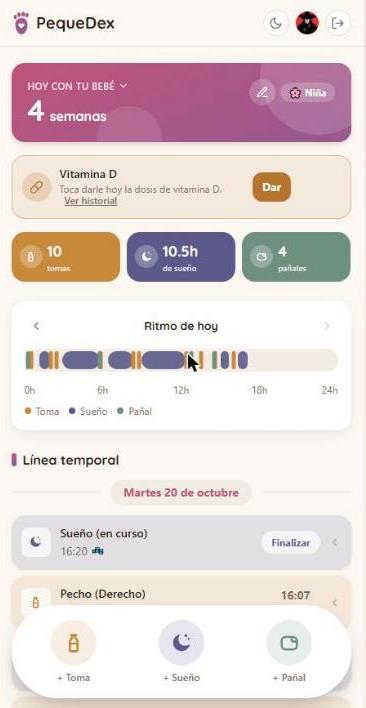

# PequeDex

[](https://github.com/OdeiRZ/PequeDex/actions/workflows/ci.yml)

Diario y seguimiento de bebé: tomas, sueño, pañales, temperatura, hitos,
crecimiento, vitamina D y vacunas, con estadísticas y PDF para el
pediatra, compartido en tiempo real entre cuidadores. Nace de una necesidad real (mi
hija nace en unas semanas) y, como [LudoDex](https://github.com/OdeiRZ/LudoDex),
está pensada primero para uso personal y abierta a que cualquiera lleve el
suyo.

**En vivo**: [odeirz.github.io/PequeDex](https://odeirz.github.io/PequeDex/)
(frontend, GitHub Pages) — [pequedex-0phw.onrender.com](https://pequedex-0phw.onrender.com)
(API, Render). La API está en capa gratuita: "duerme" tras un rato de
inactividad y el primer request tras el sueño puede tardar ~50s en
responder mientras arranca de nuevo.

Antes en Cloudflare Pages (`pequedex.pages.dev`) — migrado a GitHub Pages
el 2026-09-19 porque el dominio quedó asignado a un rango de IP de
Cloudflare (`188.114.96.0/97.0`) inalcanzable desde varias redes distintas
(confirmado con dos ISPs independientes, wifi y datos móviles, mientras
`ludodex.pages.dev`/`mira-marketlens.pages.dev` — en otro rango,
`172.66.x.x` — seguían funcionando bien), sin que Cloudflare lo resolviera
en el rato que se esperó. `web/vite.config.ts` fija `base: '/PequeDex/'`
(GitHub Pages sirve un project page bajo esa ruta, no en la raíz) y
`public/404.html` + un script en `index.html` restauran la ruta real tras
un refresh en cualquier URL que no sea la raíz — GitHub Pages no tiene
rewrite de servidor para el modo `history` de vue-router, a diferencia de
Cloudflare Pages.

## De un vistazo

<p align="center">
  
</p>

| | |
|---|---|
| **Qué resuelve** | Registrar en segundos, desde el móvil y a oscuras, lo que pasa en el día de un bebé, y llevar al pediatra un resumen en PDF. |
| **Tiempo real** | Varios cuidadores ven los mismos registros a la vez; sin conexión se guarda en el móvil y se sincroniza al volver la red. |
| **Stack** | Laravel 12 + Sanctum (API) · Vue 3 + Pinia + TypeScript (PWA) · PostgreSQL en Neon · Render + GitHub Pages |
| **Calidad** | 389 tests de backend (también contra PostgreSQL real) · 404 de frontend · pruebas end-to-end con Playwright que **bloquean el despliegue** · Sentry · copia de seguridad semanal cifrada |

**Una mejora medida de verdad:** la base de datos consumía **4,29 GB de red en
12 días** (el avatar en base64 viajaba en cada petición); tras mover la foto
fuera de las respuestas, añadir un arranque en una sola petición con ETag y
pasar la base a Fráncfort, el consumo fue de **~48,6 MB en 7 días**. El detalle
y cómo se midió está en [`api/README.md`](api/README.md) y en el
[CHANGELOG](CHANGELOG.md).

**Proyecto recién empezado** — este README se irá ampliando a medida que
avancen los hitos. Ver [CHANGELOG.md](CHANGELOG.md) para el detalle de cada
uno.

## Estructura

Repo único con dos aplicaciones independientes, cada una con su propio
`README.md`:

- [`api/`](api/README.md) — API REST en Laravel 12 + Sanctum (autenticación
  por token, no por cookie de sesión — ver la nota de arquitectura más abajo).
- [`web/`](web/README.md) — SPA en Vue 3 (Composition API, Pinia, Vue Router,
  TypeScript), consume la API por HTTP.

## Por qué esta arquitectura

- **API y frontend separados**, mismo patrón que LudoDex y MIRA MarketLens —
  una API propiamente dicha consumida por una SPA independiente, no un
  monolito con Inertia.
- **Autenticación por token Bearer (Sanctum Personal Access Tokens), no por
  cookies de sesión**: pensado para acabar en capas gratuitas con la API y
  la SPA en dominios distintos, igual que LudoDex/MIRA — un token Bearer
  evita el choque de las cookies de sesión entre dominios con las
  restricciones de cookies de terceros de los navegadores modernos, a
  cambio de guardarse en `localStorage` en vez de en una cookie `httpOnly`.
  Aceptado conscientemente: la app no maneja datos financieros ni médicos
  regulados, solo el día a día de una familia.
- **Español e inglés**, no los 5 idiomas de LudoDex/MIRA: las dos
  personas que de verdad usan la app a diario hablan español, así que
  ese sigue siendo el idioma real de la aplicación — el inglés está
  para quien la mire desde el portfolio, no porque haya usuarios
  angloparlantes reales todavía. Un visitante nuevo ve la app en el
  idioma de su navegador (cae a español si no coincide con ninguno de
  los dos); en cuanto un cuidador elige un idioma desde "Tu cuenta",
  esa preferencia queda guardada. Si hiciera falta un tercer idioma, se
  añade.
- **Pensada para dos cuidadores sobre los mismos datos**, no un usuario
  aislado: el reto de arquitectura real de esta app está en que dos
  personas (los dos padres) vean y registren lo mismo sin duplicar ni
  pisarse, no en el propio modelo de datos del bebé.

## Hitos

1. ✅ Cimientos: repo, API con auth (registro/login/logout) y SPA con las
   mismas pantallas, verificado de punta a punta en local.
2. ✅ Modelo de datos del núcleo: un bebé compartido entre cuidadores por
   código de invitación, con tomas/sueño/pañales y una línea temporal
   combinada.
3. ✅ Primeras pantallas: crear/unirse a un bebé, registro rápido y línea
   temporal, sincronizada entre cuidadores por sondeo.
4. ✅ Crecimiento con percentiles OMS (peso/talla/perímetro craneal) e
   hitos con foto (subida real de archivo, sin fuente externa de la que
   sacarla por URL).
5. ✅ Predicción de patrones de sueño: media móvil honesta sobre el
   propio historial del bebé, sin datos suficientes dice "no lo sé" en
   vez de inventar.
6. ✅ Pantallas de crecimiento, hitos y predicción de sueño, verificadas
   de punta a punta contra la API real (incluida la subida de una foto).
7. ✅ Español e inglés (según el idioma del navegador, o el que elija
   cada cuidador desde "Tu cuenta"), con esa preferencia persistente.
8. ✅ Identidad visual propia (Tailwind CSS, mobile-first con barra de
   acciones y hojas inferiores), pensada para registrar con una mano de
   madrugada, no para una captura de pantalla.
9. ✅ Despliegue real: API en [Render](https://render.com) (Docker,
   Frankfurt) + Postgres en [Neon](https://neon.tech) (Fráncfort, movido
   desde Londres el 2026-10-12 para estar junto a la API) + fotos de
   hitos en [Cloudflare R2](https://developers.cloudflare.com/r2/) +
   frontend en GitHub Pages (antes en Cloudflare Pages, ver nota arriba).
   Verificado de punta a punta contra los servicios reales (registro,
   crear un bebé, subir la foto de un hito) tras el despliegue.
10. ✅ Barra de accesos rápidos personalizable por cuidador (mínimo 3 de
    las 5 categorías), con los bloques del dashboard ligados a cada una
    apareciendo o no según la elección — ver `web/README.md`.
11. ✅ Varios bebés por cuidador: selector de bebé activo, restaurado
    entre visitas, para quien tiene más de uno vinculado a su cuenta —
    ver `web/README.md`.
12. ✅ Contador de contracciones (antes del parto): cronómetro con
    estadísticas de la última hora, línea temporal con intensidad y
    registro de rotura de bolsa de aguas, exportable a PDF — ver
    `web/README.md`/`api/README.md`.
13. ✅ Ajustes reportados en vivo tras usar la app a diario: sexo del
    bebé elegible ya al crearlo, eliminar un bebé del todo si eres su
    único cuidador (no solo "dejar de cuidarlo"), tipo de leche en
    tomas de pecho y color de las heces en pañales sucios — ver
    `web/README.md`/`api/README.md`.
14. ✅ Rediseño del arranque de la app: pantalla de bienvenida propia
    (antes redirigía directo a Login), instalable de verdad como PWA
    en Android/iOS, y un asistente paso a paso para crear el perfil
    del bebé en vez de un formulario plano — ver CHANGELOG.md.
15. ✅ Recordatorio diario de vitamina D por bebé, con registro de qué
    días se dio e historial — ver `web/README.md`.
16. ✅ Estadísticas útiles de verdad: selector de periodo (7 días, 30
    días, todo) con comparación frente al periodo anterior, sueño sin
    suponer horarios "normales" (tramo más largo y su evolución
    semanal, reparto día/noche por franja de reloj), pañales por
    contenido (con pis / con caca), bandas de percentiles de la OMS en
    las gráficas de crecimiento y un PDF que calca la pantalla — ver
    `web/README.md`/`api/README.md`.
17. ✅ Temperatura: registro con el lugar de la toma (y uno preferido
    por defecto), nivel de color en la línea temporal, tarjeta de las
    últimas 48 h con aviso para menores de 3 meses, y bloque en
    estadísticas y PDF.
18. ✅ Avisos suaves en el Dashboard ("lleva 3 días sin caca", "hoy
    pocos pañales con pis"), que nunca diagnostican y remiten al
    pediatra, desactivables.
19. ✅ Vacunas y revisiones: cartilla digital por bebé con el calendario
    común del Consejo Interterritorial 2026 o el de su comunidad
    (las 17 comunidades + Ceuta y Melilla, recopilados en 2026),
    editable, y revisiones con el pediatra. Las plantillas son
    ficheros de datos: actualizar una comunidad es editar su fichero.
    **Pendiente de revisar:** Aragón, Asturias, Región de Murcia,
    Navarra, Ceuta y Melilla solo aplican el cambio de meningococo
    (MenACWY); no se encontró su calendario oficial de 2026 legible
    (en Ceuta y Melilla falta además la hepatitis A, que sí vacunan).
20. ✅ Resumen para la consulta: un PDF de una página con los últimos
    14 días y una ficha grande del bebé (nombre, edad, sexo, nacimiento),
    más una gráfica del sueño de los últimos 7 días, el color de las
    cacas y, si se escriben, las preguntas para el pediatra al final.
    Se elige en una hoja con dos filas iguales (para ti / para el
    pediatra).

## Copias de seguridad

Neon gratuito solo conserva 6 horas de historial, así que
`.github/workflows/backup.yml` hace cada domingo (y a mano) un volcado de
la base de datos, lo **cifra** (el repositorio es público y sus artefactos
los puede descargar cualquiera con sesión de GitHub) y lo guarda 90 días
como artefacto. No lleva sesiones, tokens de acceso ni cachés. Sin coste:
Actions es gratuito en repositorios públicos y el volcado son pocos MB.

**Puesta en marcha** (una vez; los valores los pones tú):

```
gh secret set NEON_DATABASE_URL   # cadena de conexión DIRECTA de Neon (no la "pooled")
gh secret set BACKUP_PASSPHRASE   # contraseña de cifrado; guárdala aparte
gh workflow run backup.yml        # primera copia, para comprobar que funciona
```

**Restaurar** (en un proyecto o rama nueva de Neon, nunca sobre producción
sin mirar antes):

```
gh run download <id-de-la-ejecución> -n pequedex-backup-<id>
gpg --decrypt pequedex.dump.gpg > pequedex.dump
pg_restore --no-owner --no-privileges --clean --if-exists -d "<cadena-destino>" pequedex.dump
```

**Mudar de base de datos** (p.ej. a otra región de Neon) o recuperarse de un
desastre, sin instalar nada: `.github/workflows/restore-database.yml`
descifra una copia y la restaura en OTRA base de datos dentro de GitHub.
Pasos: crear la base de datos de destino vacía; guardar su cadena directa
como secreto `RESTORE_TARGET_DATABASE_URL`; lanzar el workflow con el número
de la ejecución del backup (`gh workflow run restore-database.yml -f
backup_run_id=<id>`); comparar los recuentos que imprime con los del origen;
cambiar las variables `DB_*` de Render a la nueva base de datos y actualizar
el secreto `NEON_DATABASE_URL` de las copias. Se niega a restaurar sobre una
base de datos con tablas o sobre el propio origen de las copias.

Al restaurar hay que volver a iniciar sesión (los tokens no se copian).
Una copia que nunca se ha restaurado no es una copia: conviene probar la
restauración una vez en un proyecto de pruebas.

## Antes de subir: `scripts/verify.ps1`

Un solo comando que pasa en local todo lo que pasa la CI, y se para en el primer
fallo diciendo cuál:

```
./scripts/verify.ps1            # todo, con e2e (unos minutos)
./scripts/verify.ps1 -SkipE2E   # sin Playwright
```

Backend: Pint, PHPStan, Pest sobre SQLite y sobre PostgreSQL, `composer audit`.
Frontend: Prettier, ESLint, tipos, Vitest, build, `npm audit` y e2e.

**PostgreSQL local, recomendado.** La CI también corre las pruebas sobre
PostgreSQL (job "Backend on PostgreSQL") y una vez falló solo ahí: un error de
clave única deja abortada la transacción en curso (`SQLSTATE[25P02]`), algo que
SQLite no hace. Sin Docker, basta un PostgreSQL 18 **portátil** (el zip de
binarios de EnterpriseDB, sin instalador ni servicio de Windows) descomprimido
en `~\.claude\tools\postgres18` (o donde indique `PEQUEDEX_PG_DIR`), con un
clúster creado con `initdb -U postgres` (contraseña `postgres`) y una base
`pequedex_test`, en el puerto 5433. El script lo arranca si hace falta, lo
usa y lo para; si no existe, avisa y se salta ese paso.

## Licencia

[AGPLv3](LICENSE).

## Autor

Odei Riveiro Zafra
